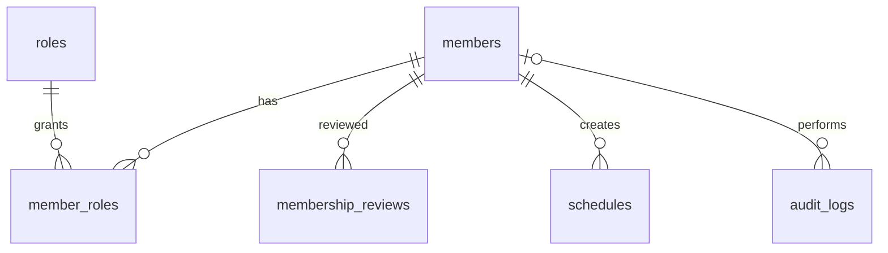
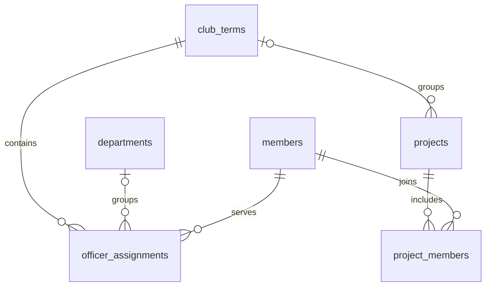
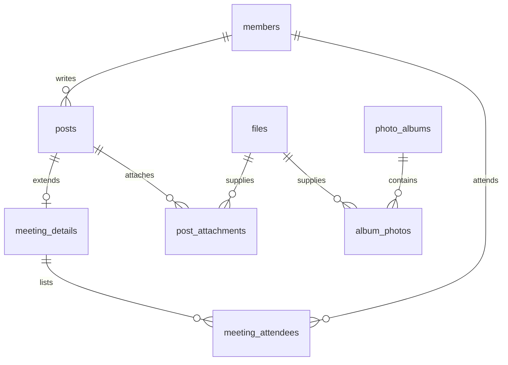
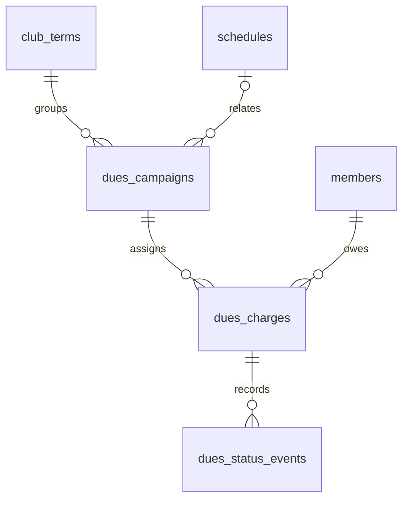
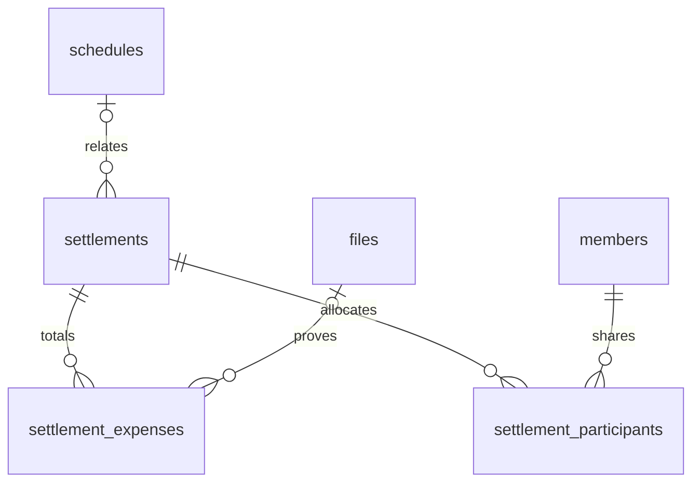
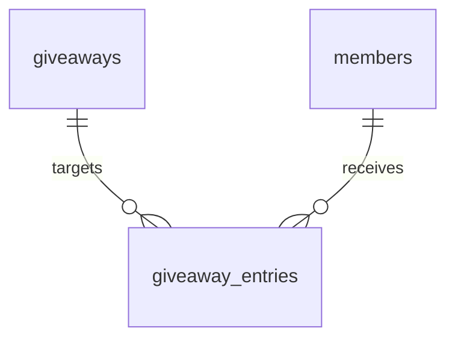

# 세미콜론 DB 설계 v0.1

상태: **검토 가능한 설계 초안**. MySQL 8.4 기준이며 실제 데이터베이스에 적용하지 않았습니다.

- [전체 컬럼·키 사전](database-dictionary.md)
- [MySQL 테이블 생성 SQL 초안](database-schema.sql)
- [확정한 기능·가입 정책](feature-plan.md)

## 1. 설계 범위와 확정 사항

회원 가입·승인, 조직도, 일정, 회의록·프로젝트, 자료실, 사진, 회비·정산, 이벤트 당첨 조회까지 Figma의 기능을 대상으로 합니다. 하나의 학회를 위한 서비스로 설계합니다.

사용자가 확정한 내용:

- 소개·공개 활동·모집 및 가입 안내는 누구나 봅니다.
- 내부 일정·회의록·자료실·개인 회비는 승인된 회원이 로그인한 뒤 이용합니다.
- 회원가입 필수 입력은 이름·학번·이메일·비밀번호입니다.
- 회원가입 후 운영진의 승인이 필요합니다.

이번 설계에서 제안하는 기본값은 다음과 같습니다. 실제 운영 규칙으로 확정된 것은 아닙니다.

| 설계 기본안 | 채택한 이유 | 구현 전 검토할 내용 |
| --- | --- | --- |
| 이메일·학번 각각 중복 불가 | 같은 사람의 중복 신청과 중복 회비 부과 방지 | 학번 변경, 탈퇴·재가입과 이메일 변경 절차 |
| 회원·운영진·회계 담당·최고 관리자 권한 | 게시물 관리와 회계 접근 구분 | 누가 승인·권한 부여를 담당할지 |
| 회비는 항목별 전액 납부 또는 면제 | 현재 시안의 납부 완료·미납 흐름을 단순하게 구현 | 부분 납부·환불·과입금이 필요하면 별도 입금 원장을 추가해야 함 |
| 정산은 참가 회원의 균등 분담 | 현재 시안의 1인당 금액 계산 지원 | 면제·차등 분담·선결제자 환급 방식 |
| 운영 기록을 가진 회원은 상태로 비활성화 | 이전 회비·회의 기록의 연결 유지 | 실제 탈퇴와 보관 기간, 익명화·삭제 절차 |

로그인 식별자와 이메일 확인 방식은 아직 미정입니다. 이메일과 학번이 모두 고유하므로 이후 어느 쪽을 로그인에 사용할지 정할 수 있습니다.

## 2. 전체 테이블 구성

총 **26개 테이블**입니다. 모든 테이블을 처음부터 구현할 필요는 없습니다.

| 영역 | 테이블 | 저장하는 내용 |
| --- | --- | --- |
| 회원 | `members` | 가입 정보와 현재 승인 상태 |
| 권한 | `roles`, `member_roles` | 운영 권한 코드와 회원별 권한 |
| 승인 이력 | `membership_reviews` | 승인·반려·정지 등 변경 내역 |
| 학기·조직도 | `club_terms`, `departments`, `officer_assignments` | 학기·기수, 부서와 역대 운영진 |
| 일정 | `schedules` | 날짜·장소·분류·대상 |
| 프로젝트 | `projects`, `project_members` | 진행률·상태와 참여 회원 |
| 게시물 | `posts` | 공지·공개 활동·회의록·자료실의 공통 제목과 본문 |
| 회의록 | `meeting_details`, `meeting_attendees` | 회의 시각·장소와 참석자 |
| 파일 | `files`, `post_attachments` | 파일 저장 위치·크기와 게시물 연결 |
| 사진 | `photo_albums`, `album_photos` | 앨범과 사진 순서·설명 |
| 회비 | `dues_campaigns`, `dues_charges`, `dues_status_events` | 학기·행사 회비, 회원별 납부, 변경 이력 |
| 정산 | `settlements`, `settlement_expenses`, `settlement_participants` | 행사 지출과 참가자별 확정 분담액 |
| 당첨 조회 | `giveaways`, `giveaway_entries` | 이벤트와 대상 회원별 결과 |
| 운영 기록 | `audit_logs` | 권한 변경·공개·정산 확정 등 중요 작업 |

### 처음 구현할 6개 테이블

`members`, `roles`, `member_roles`, `membership_reviews`, `schedules`, `audit_logs`부터 구현합니다. 이 여섯 테이블은 나머지 테이블 없이 만들 수 있습니다.

1. 가입 신청을 `PENDING`으로 저장합니다.
2. 운영진이 승인하면 상태와 권한·승인 이력을 같은 작업으로 기록합니다.
3. 승인된 회원이 일정 목록을 조회하게 만듭니다.
4. 다음으로 게시물·자료·사진, 학기·조직도·프로젝트를 추가합니다.
5. 회비·정산과 당첨 발표는 운영 규칙 검토 후 추가합니다.

## 3. 회원과 권한

### 회원 정보

`members.id`는 내부에서 연결에 사용하는 회원 번호입니다. 이름·학번이 바뀌어도 연결이 유지되도록 다른 테이블은 이름이나 학번 대신 이 번호를 참조합니다.

| 핵심 컬럼 | 설명 |
| --- | --- |
| `id` | 내부 회원 번호 |
| `name`, `student_number`, `email` | 사용자가 입력한 가입 정보 |
| `password_hash` | 비밀번호 원문을 복구할 수 없는 검증용 해시 |
| `status` | 승인 대기·승인·반려·정지·탈퇴 상태 |
| `applied_at` | 현재 가입 신청 시각 |
| `approved_at`, `approved_by` | 마지막 승인 시각과 처리자 |
| `email_verified_at` | 이메일 확인 절차 도입 시 사용 |
| `version` | 동시에 처리된 승인·수정 충돌 확인 |

비밀번호는 Spring Security의 `PasswordEncoder`로 처리합니다. 비밀번호 원문·해시 모두 회원 조회와 운영진 API 응답에서 제외합니다. [Spring Security 비밀번호 저장 안내](https://docs.spring.io/spring-security/reference/features/authentication/password-storage.html)

### 승인 상태와 운영 권한의 차이

- **상태:** 이 사람이 내부 기능을 이용해도 되는 회원인지 판단합니다.
- **권한:** 승인된 회원이 어떤 작업을 할 수 있는지 판단합니다.

상태가 `PENDING`, `REJECTED`, `SUSPENDED`, `WITHDRAWN`이면 운영 권한 행이 남아 있어도 내부 기능에 접근시키지 않습니다.

| 상태 코드 | 의미 | 내부 기능 |
| --- | --- | --- |
| `PENDING` | 가입 신청·승인 대기 | 불가 |
| `APPROVED` | 승인된 회원 | 권한 범위 내 허용 |
| `REJECTED` | 신청 반려 | 불가 |
| `SUSPENDED` | 이용 정지 | 불가 |
| `WITHDRAWN` | 탈퇴·비활성 상태 | 불가 |

`PENDING → APPROVED/REJECTED`, `APPROVED → SUSPENDED/WITHDRAWN` 등을 기본 흐름으로 제안합니다. 재신청·복구는 운영 규칙 확정 후 API에서 허용할 전이를 정합니다.

| 권한 코드 | 제안하는 범위 |
| --- | --- |
| `MEMBER` | 내부 자료 열람, 자기 회비·당첨 결과 조회 |
| `STAFF` | 회원 신청 확인·승인, 일정·게시물·사진·이벤트 관리 |
| `TREASURER` | 회비 대상자·납부 확인·정산 관리 |
| `ADMIN` | 전체 관리와 운영 권한 부여·회수 |

한 사람이 운영진과 회계 권한을 함께 가질 수 있으므로 `member_roles`로 연결합니다. `expires_at`이 지났으면 권한을 허용하지 않습니다. 조직도의 학회장·부장 직책은 설명 정보이며 운영 권한을 자동 부여하지 않습니다.

공개 가입 요청에서 `status`와 `role`을 입력받지 않습니다. 최초 `ADMIN`은 별도 초기 설정 절차로 생성하고 기록합니다. 이 초기 설정을 제외하면 자기 가입을 스스로 승인하는 흐름을 허용하지 않는 안을 제안합니다.

### 승인 처리 한 번에 할 일

하나의 DB 트랜잭션에서 대상 회원을 잠그고 다음을 처리합니다.

1. 처리자가 승인된 회원이며 유효한 승인 권한을 가졌는지 검사합니다.
2. 대상 상태가 여전히 `PENDING`인지 확인합니다.
3. `APPROVED`, 승인 시각·처리자, 버전을 갱신합니다.
4. 일반 회원 권한을 부여하고 `membership_reviews`를 기록합니다.

중간에 실패하면 전체를 취소합니다. 상태만 승인되고 권한·이력이 빠지는 것을 방지합니다.

## 4. 학기·조직도·프로젝트

학기 정보는 매년 새 행으로 추가합니다. 올해 운영진으로 바뀌어도 작년 운영진 기록을 덮어쓰지 않습니다. 부서 개편 시에는 이전 부서 이름을 덮어쓰는 대신 새 부서 행을 만들고 해당 기수에 연결합니다. 조직도는 기수별 배치, 프로젝트는 별도의 참여 회원 관계로 관리합니다.

프로젝트의 `progress_percent`는 0~100이고, 기술 태그는 단순 문자열 배열로 저장합니다. 프로젝트 참여자·금액·권한 등 관계를 가져야 하는 정보는 JSON에 넣지 않습니다.

## 5. 게시물·회의록·파일·사진

공지·활동·회의록·자료실은 제목·본문·작성자·공개 상태가 같아서 `posts.kind`로 구분합니다. 회의에만 필요한 날짜·참석자는 별도 테이블에 둡니다.

- 공개 조회 조건은 `visibility = PUBLIC` **그리고** `publication_status = PUBLISHED` **그리고** 삭제되지 않음입니다.
- 회의록·자료실은 DB 제약으로 `PUBLIC`을 허용하지 않습니다. 내부 일정도 `MEMBERS` 또는 `STAFF`만 허용합니다.
- `meeting_details`는 `MINUTES` 게시물에만 연결하고, 회의록을 발행할 때 상세 정보의 존재를 확인합니다. FK만으로 게시물 종류까지 검증하지는 못합니다.
- 공개 활동 글에 내부 일정·프로젝트가 연결되어 있어도 공개 API는 내부 상세 정보를 자동으로 함께 반환하지 않습니다.
- 회원 이름·학번·이메일·회비 정보를 공개 게시물의 연관 객체로 자동 직렬화하지 않습니다.

파일 본체는 파일 저장소에 두고 DB에는 객체 키·파일명·크기·업로더를 저장합니다. 자료실에는 `RESOURCE` 게시물과 첨부 파일을 연결하고, 앨범에는 사진 파일을 연결합니다.

파일 저장소는 기본 비공개로 두고, 다운로드 API는 **요청한 게시물·앨범·영수증의 접근 권한**을 확인합니다. `files.id`만 알면 내려받을 수 있는 범용 공개 API를 만들지 않습니다. 외부 파일 접근을 허용할 경우 권한 확인 후 제한된 수명의 URL 등을 발급합니다.

공개 앨범에는 공개 대상으로 선정한 사진만 연결합니다. 영수증처럼 회계용으로 사용한 파일이 공개 게시물·앨범에 재사용되지 않도록 연결·공개 시 검사합니다. 업로드 완료 상태가 `READY`인 파일만 발행된 콘텐츠에서 사용합니다.

학회 소개 문구와 연락 안내는 첫 버전에서 프론트엔드 설정으로 관리합니다. 운영진이 웹에서 편집하는 기능이 필요해지면 별도 설정 테이블을 추가합니다.

## 6. 회비와 납부 확인

`dues_campaigns`는 '2026-2 학회비', '가을 MT 참가비' 같은 납부 항목이고, `dues_charges`는 각 대상 회원에게 실제로 부과한 한 건입니다. 한 회원에게 같은 항목을 중복 부과하지 못하도록 `(campaign_id, member_id)`를 고유키로 둡니다.

대상자를 확정할 때 회원별 부과 행을 만듭니다. 이후 새로운 회원이 가입해도 과거 학기 납부 대상 인원이 자동으로 바뀌지 않습니다. 항목의 기본 금액을 나중에 수정해도 이미 부과한 금액은 유지합니다.

계좌·예금주·입금자명 안내는 회비 항목에 저장할 수 있습니다. 실제 계좌 값은 설계 SQL에 넣지 않습니다.

### 납부 상태

`UNPAID → PAYMENT_REPORTED → PAID`가 기본 흐름입니다. 면제는 `WAIVED`로 구분합니다.

- 회원의 '입금했어요'는 확인 대기로만 전환합니다.
- `PAID`와 `WAIVED`는 회계 권한자가 확인 시각·처리자를 기록해야 합니다.
- 운영진이 은행 내역을 먼저 확인한 경우 신고 없이 미납에서 납부 완료로 처리할 수 있습니다.
- 확인 반려·납부 취소·면제·금액 정정은 이유와 이전 값을 `dues_status_events`에 남깁니다.
- 납부 상태 갱신과 이력 추가는 같은 트랜잭션으로 처리하고, `version` 또는 행 잠금으로 중복 처리를 막습니다.

입금 신고 버튼을 반복해서 눌러도 상태가 이미 확인 대기이면 같은 결과를 반환하고 이력을 중복 생성하지 않습니다. 금액 정정은 미납·작성 중 항목에 한정하는 안을 제안합니다. 납부 완료 금액의 정정·환불 정책은 후속 결정이 필요합니다.

집계 값은 원본 행에서 계산합니다.

- 부과 인원: 해당 항목의 `dues_charges` 수
- 납부 인원·수납액: `PAID` 행의 수와 `amount_won` 합계
- 면제 인원: `WAIVED` 행 수
- 미수액: `UNPAID`, `PAYMENT_REPORTED` 행의 금액 합계

이 설계의 납부 상태는 운영진의 확인 기록입니다. 은행과 자동 연동해 입금을 검증하는 기능은 포함하지 않습니다. 부분 납부·여러 번 입금·환불이 필요해지면 이 상태 표에 금액 컬럼을 계속 붙이지 않고 별도 입금·환불 원장 설계를 추가합니다.

## 7. 행사 정산

지출은 `수량 × 원화 단가`로 합산합니다. 참가자는 한 정산에 한 번만 연결합니다. 모든 금액은 원 단위 정수로 저장하고, 부동소수점으로 계산하지 않습니다.

초안은 면제자를 제외한 회원의 균등 분담입니다. 총액을 인원으로 나눈 몫을 배분하고, 남은 1원은 내부 회원 번호 오름차순으로 한 명씩 더하는 방식으로 총액을 보존합니다. 예: 46,700원 / 3명 → 15,567원 + 15,567원 + 15,566원. 이 분배 순서는 운영 정책 검토 대상입니다.

`DRAFT`에서 계산한 뒤 확정할 때 `settlement_participants.allocated_amount_won`에 결과를 저장합니다. 이후 참가 인원이 바뀌어도 확정 당시 금액을 재계산해 덮어쓰지 않습니다.

확정 트랜잭션의 조건:

1. 정산 부모 행을 잠그고 상태가 `DRAFT`인지 확인합니다.
2. 지출 수정·참가자 추가 API도 같은 부모 행을 먼저 잠그도록 구현합니다.
3. 분담 대상이 1명 이상인지, 모든 확정 분담액이 존재하는지 확인합니다.
4. 면제자 분담액이 0이고, 분담액 합계가 지출 합계와 정확히 같은지 검사합니다.
5. 확정 금액·처리자·시각·작업 이력을 한 번에 저장합니다.

확정 후 지출·참가자·분담액을 수정하지 않습니다. 정정이 필요하면 권한자에게 취소·새 정산 등의 흐름을 제공하는 정책을 먼저 정합니다. 선결제자는 기록할 수 있지만, 선결제액을 차감한 순수 송금액 계산·실제 송금 추적·회비 부과 연결은 아직 확정하지 않았습니다.

## 8. 이벤트 당첨 결과

동명이인을 이름으로 구분하지 않고 내부 회원 번호로 연결합니다. 한 이벤트와 회원의 조합은 한 행만 존재합니다.

결과는 `PENDING`, `WINNER`, `NOT_WINNER`로 관리합니다. 일괄 수정과 발표는 트랜잭션으로 처리합니다. 대상자 추가는 승인된 회원에 한정하고, 발표 전에는 미확정 결과를 회원 조회 API에서 반환하지 않습니다. 발표하려면 모든 대상자의 결과를 확정해야 합니다.

회원은 본인 결과를 조회하고 운영진은 대상자와 결과를 관리하는 안입니다. 무작위 추첨, 응모 기능, 전체 당첨자 명단 공개는 현재 설계에서 결정하지 않았습니다.

## 9. 공통 DB 규칙

- PK/FK는 같은 `BIGINT UNSIGNED` 타입을 사용합니다. 학번·계좌·이메일은 숫자로 계산하지 않는 문자열입니다.
- 테이블은 InnoDB, 일반 문자셋은 `utf8mb4`입니다. 이메일의 고유키는 대소문자 비구분·악센트 구분 비교를 제안합니다.
- 날짜·시간은 애플리케이션에서 UTC로 기록하고 화면에서는 Asia/Seoul로 표시합니다. 학기·행사 날짜처럼 날짜만 뜻하는 값은 `DATE`를 사용합니다.
- 종일 일정은 한국 시간의 `[첫날 00:00, 마지막 날의 다음 날 00:00)` 구간을 UTC로 변환해 저장합니다. 종료 시각을 포함하지 않으며, 저장할 때 종료 시각에서 1마이크로초를 빼지 않습니다. 조회 시 `starts_at < 조회종료 AND ends_at > 조회시작`으로 겹치는 일정을 찾습니다.
- 회원 이력과 회계 자료의 참조는 `ON DELETE RESTRICT`를 사용합니다. 학기 전환이나 회원 비활성화로 이전 회계 내역을 삭제하지 않습니다.
- 전체 이름·학번·이메일·비밀번호·인증 토큰 원문을 `audit_logs.details`에 넣지 않습니다. 상태·권한 코드와 대상 ID 등 필요한 값만 허용합니다.

FK는 참조 존재·타입 등의 무결성에 사용합니다. 실제 로그인 여부·권한, 다른 행과의 합계, 게시물 종류와 하위 정보의 일치까지 보장하지는 않습니다. [MySQL FK 안내](https://dev.mysql.com/doc/refman/8.4/en/create-table-foreign-keys.html)

`CHECK`는 같은 행의 날짜 순서·범위·필수 확인 정보처럼 검증할 수 있는 조건에 사용합니다. 다른 행의 합계나 역할 검사 등은 서비스 트랜잭션에서 검증합니다. [MySQL CHECK 안내](https://dev.mysql.com/doc/refman/8.4/en/create-table-check-constraints.html)

### 자주 쓰는 조회를 위한 인덱스

| 조회 | 주요 인덱스 |
| --- | --- |
| 승인 대기 목록 | `members(status, applied_at)` |
| 월별 내부 일정 | `schedules(visibility, starts_at)`, 종료 시각 인덱스 |
| 종류별 공개 게시물 | `posts(kind, visibility, publication_status, published_at)` |
| 학기별 회비 | `dues_campaigns(term_id, status, due_at)` |
| 회원의 미납 내역 | `dues_charges(member_id, status)` |
| 회비 항목별 납부 현황 | `dues_charges(campaign_id, status)` |
| 회원 승인·회비 변경 이력 | 대상 ID와 생성 시각의 복합 인덱스 |

인덱스는 실제 데이터와 조회 성능을 본 뒤 조정합니다. 전체 명세는 컬럼 사전과 SQL에 있습니다.

## 10. 아직 정해야 할 운영 규칙

- 이메일과 학번 중 로그인에 사용할 식별자, 이메일 소유 확인·비밀번호 재설정 방식
- 학번의 정확한 형식과 학교가 인정하는 학회원 확인 기준
- 신청 반려·재신청·졸업·탈퇴와 정보 보관·삭제 절차
- 권한 부여 담당자와 운영진 임기 만료 처리
- 파일 크기·종류·공개 사진 선정 기준과 파일 저장소
- 부분 납부·환불·과입금과 정산의 차등 분담 여부

세션·인증 토큰·비밀번호 재설정 토큰은 인증 구현 방식을 고를 때 별도의 인프라 테이블이나 저장소로 설계합니다. 이 파일이 로그인 구현을 완료했다는 뜻은 아닙니다.

## 11. SQL 검증과 적용 범위

26개 테이블·216개 컬럼·52개 FK의 대상 존재, FK 타입·고유키 일치, 제약 이름 중복, 생성 순서를 정적으로 검사했습니다. `node-sql-parser 5.4.0`의 MySQL 문법 검사에서 테이블 생성 26개와 권한 코드 삽입 1개, 총 27개 구문이 파싱됐습니다.

현재 PC에는 MySQL/Docker가 없어 **MySQL 8.4 서버에서 생성·삽입을 실행한 검증은 하지 않았습니다.** SQL 파서 검사는 실제 엔진 실행 검증을 대신하지 않습니다.

`database-schema.sql`은 검토용 전체 DDL이며 Spring Boot가 자동 실행하는 파일이나 정식 Flyway 마이그레이션이 아닙니다. 서비스 코드·실제 DB·기존 데이터는 변경하지 않습니다. 구현 단계에서 1차 테이블부터 MySQL 통합 검증을 하고, 선택한 변경 적용 도구로 버전을 나눠 반영합니다.
